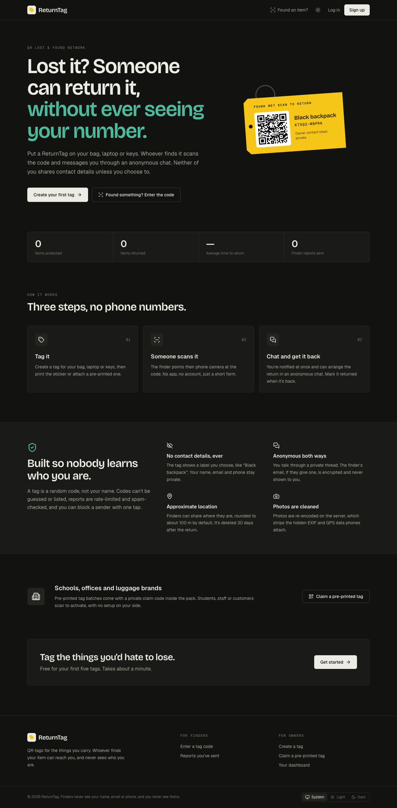
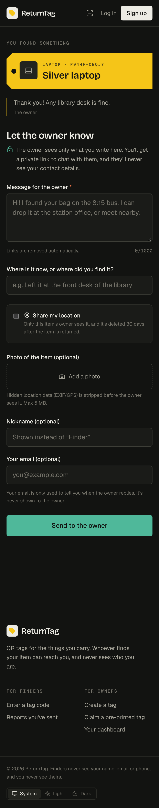
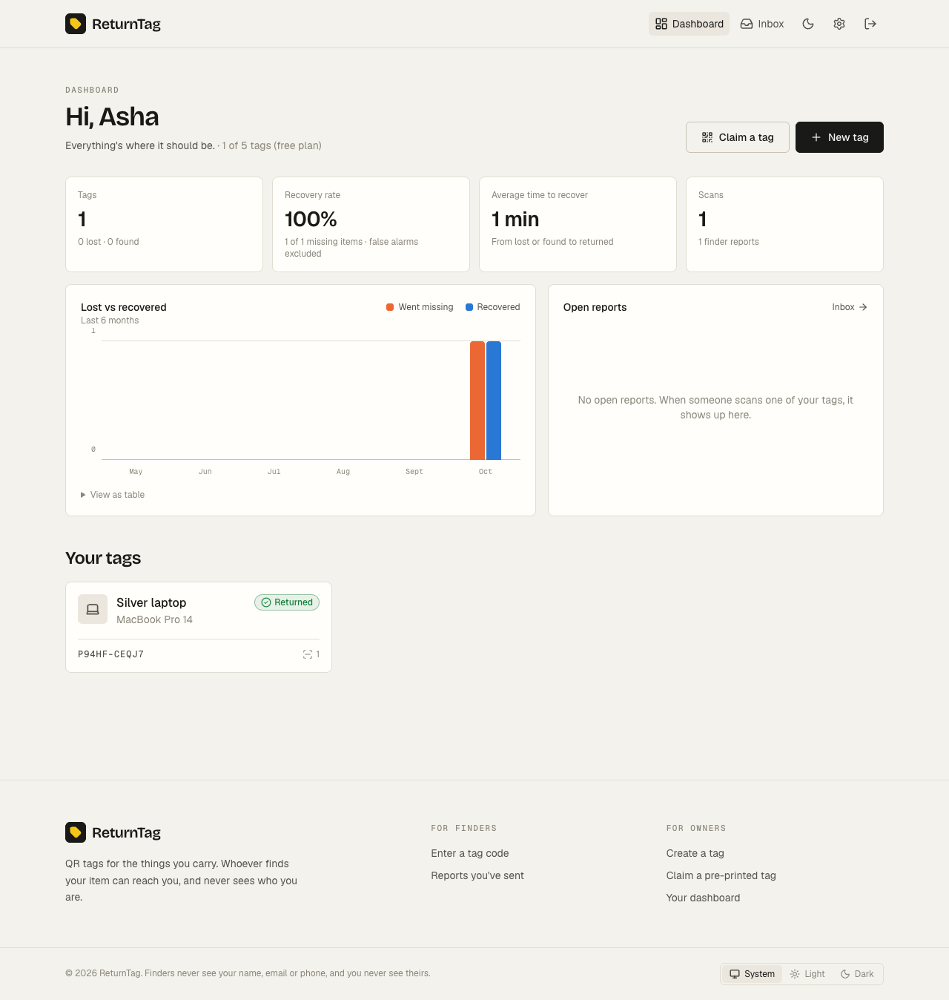
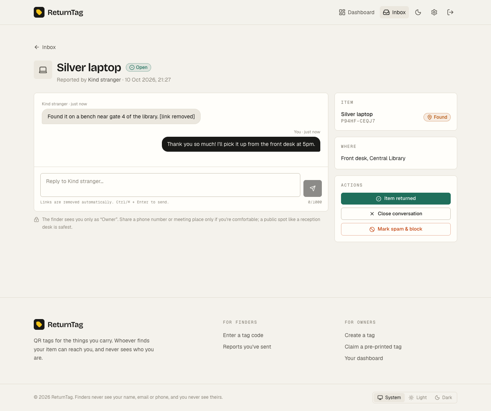
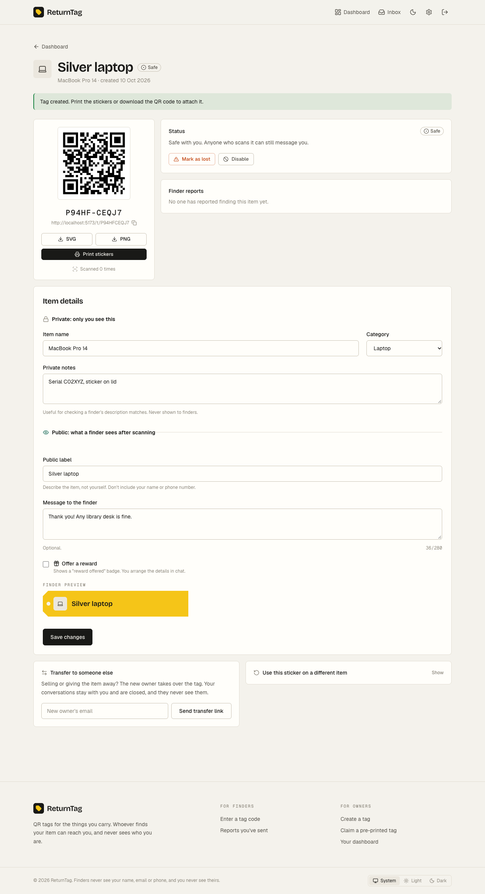
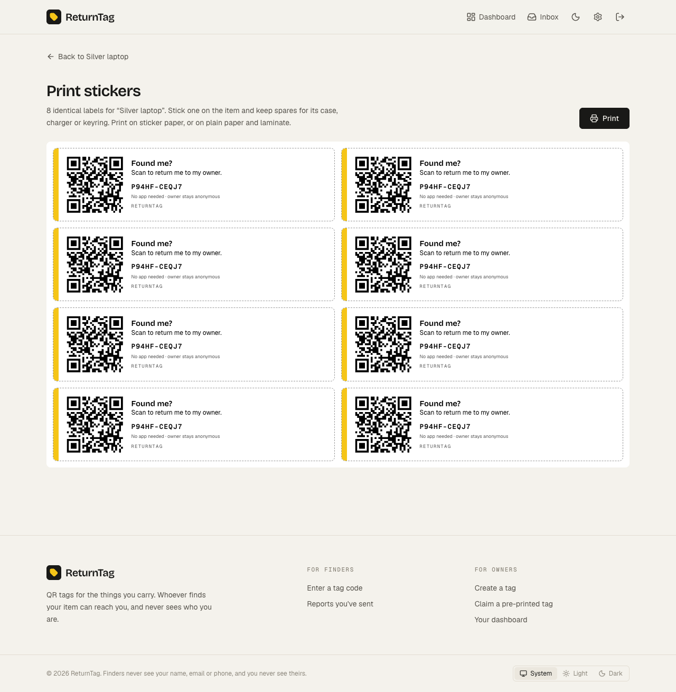
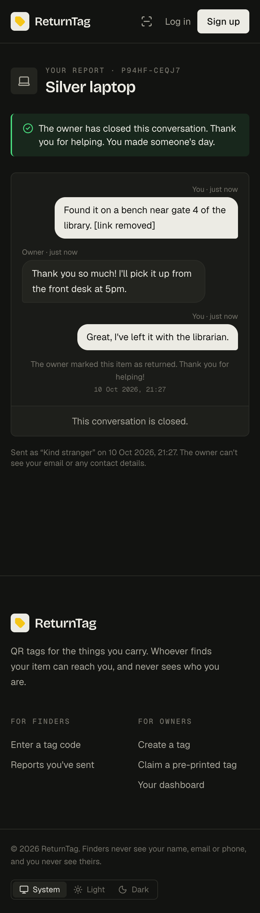

# ReturnTag: QR Lost & Found Network

A full-stack MERN app and installable PWA for attaching QR tags to bags, laptops, keys and other belongings. Anyone who finds a tagged item scans the code with their phone camera and can message the owner. The finder never sees the owner's contact details, and the owner never sees the finder's.

<!-- Live demo: add your Vercel link here once deployed -->

<p align="center">
  
  
</p>

## Features

- **QR tags linked to your account.** Download the QR as SVG/PNG or print a sticker sheet.
- **No-account finder flow.** Scanning opens a phone-friendly page showing only what the owner chose to make public (e.g. "Black backpack", a thank-you note, a reward badge).
- **Anonymous chat** between owner and finder. The finder gets a private link, and an email address is optional.
- **Lost / found / returned statuses.** A finder's report flips a tag to *found* even if the owner hadn't noticed the item was missing.
- **Recovery statistics:** recovery rate, average time to recovery, a 6-month activity chart, and scan counts.
- **Email and push notifications** when someone finds your item or replies.
- **Tag reassignment:** transfer a tag to someone else (e.g. when you sell the bag), or relink the same sticker to a new item.
- **Pre-printed tag batches** for schools and businesses. Each tag is activated with a secret claim code.
- **Admin console:** batches, flagged spam, global stats, and plan upgrades.
- **Installable PWA** that works offline for the app shell. Light and dark mode.

## Screenshots

**Owner dashboard and anonymous chat**

<p align="center">
  
  
</p>

**Tag page, printable stickers, and the finder's private chat link**

<p align="center">
  
  
  
</p>

## Privacy and abuse protection

| Concern | How it's handled |
|---|---|
| Owner identity | Public endpoints return only the public label, message, category and reward flag. Tests assert that no owner fields leak. |
| Finder identity | The nickname is optional. The finder's email is **AES-256-GCM encrypted** and only used to notify them of replies. IPs are stored only as an **HMAC**. |
| Finder access | A 256-bit random token is issued per report, and **only its SHA-256 is stored**. It lives in the URL fragment (`/r/<id>#<token>`), so it never reaches server logs or `Referer` headers. A wrong token gets the same 404 as a missing report. |
| Location | Opt-in only, and rounded to about 110 m unless the finder picks "exact". Scans never record location. |
| Photos | Re-encoded with sharp, which strips all EXIF/GPS metadata. Served only to the report's owner. |
| Retention | 30 days after a conversation closes, the location, photo, finder email and IP hash are deleted automatically. |
| Spam | Honeypot field, minimum form time, optional Cloudflare Turnstile, per-IP rate limits, at most 5 reports per tag per hour and 20 per sender per day, and links stripped from messages. "Mark spam" blocks that sender from all of the owner's tags. |
| Enumeration | 10-character codes from a 30-symbol alphabet (about 5.9 × 10¹⁴ combinations), plus rate-limited lookups. Claim codes are HMAC'd and single-use. |
| Reassignment | Each report stays with the owner *at the time of the report*. After a transfer, the new owner can't read old conversations, and the previous owner's private notes are cleared. |
| Injection | Every request field is type-checked, so `{ "$gt": "" }` is rejected before it reaches MongoDB. |

## Tech stack

- **Client:** React 19, Vite 8, React Router 7, Tailwind CSS 4, vite-plugin-pwa, `qrcode`, lucide-react, axios
- **Server:** Node 20+, Express 5, Mongoose 9 (MongoDB Atlas), JWT + bcrypt, helmet, express-rate-limit, multer + sharp, nodemailer, web-push, nanoid
- **Tests:** `node:test` + supertest + mongodb-memory-server (32 integration tests that never touch Atlas)

## Project structure

```
Return-Tag/
├── client/              React PWA (see client/src/pages for every screen)
├── server/
│   ├── src/
│   │   ├── config/      env validation, MongoDB connection
│   │   ├── models/      User, Tag, Report, Message, Incident, Photo, Block, TagBatch
│   │   ├── controllers/ auth, tags, public (finder), reports (owner), stats, admin, push
│   │   ├── services/    tagLifecycle (status rules), notify (email + push), captcha
│   │   ├── middleware/  auth, rate limits, upload, errors
│   │   ├── jobs/        purge (data retention)
│   │   └── utils/       codes, crypto, validation, serializers
│   ├── scripts/         generate-secrets, make-admin
│   └── tests/
└── docs/API.md          every endpoint and response shape
```

## Getting started

Requires Node 20+ and a MongoDB Atlas cluster (the free M0 tier is fine).

```bash
# 1. API
cd server
npm install
cp .env.example .env          # fill in MONGO_URI
npm run generate-secrets      # paste the output into .env
npm run dev                   # http://localhost:8001

# 2. Client (second terminal)
cd client
npm install
npm run dev                   # http://localhost:5173
```

To get the admin console, list your email in `ADMIN_EMAILS` in `server/.env`; that account becomes an admin when it registers or logs in. For an account that already exists, you can also run:

```bash
cd server && npm run make-admin -- you@example.com
```

**Testing QR codes on your phone:** set `PUBLIC_APP_URL` in `server/.env` to your computer's LAN address (e.g. `http://192.168.1.20:5173`), restart the server, and create a new tag. Vite already listens on the network, so a phone on the same Wi-Fi can scan it.

**Email:** without SMTP settings, emails (including finder links and transfer links) are printed to the server console. For Gmail, set `SMTP_HOST=smtp.gmail.com`, `SMTP_PORT=465`, `SMTP_USER` to your address and `SMTP_PASS` to a 16-character [App Password](https://myaccount.google.com/apppasswords).

### Scripts

| Where | Command | What it does |
|---|---|---|
| server | `npm run dev` | API with auto-reload |
| server | `npm test` | Integration tests on an in-memory MongoDB |
| server | `npm run generate-secrets` | New JWT/encryption/HMAC secrets and VAPID keys |
| server | `npm run make-admin -- <email>` | Grants the admin role |
| client | `npm run dev` / `build` / `lint` | Vite dev server, production build, oxlint |

## Tag lifecycle

```
active ──owner marks lost──► lost ──finder reports──► found ──owner confirms──► returned
   │                                                    ▲
   └──── finder reports (owner hadn't noticed yet) ─────┘
```

| Change | Trigger |
|---|---|
| `active` / `returned` → `lost` | Owner marks it lost |
| `active` / `lost` / `returned` → `found` | A finder sends a report |
| `lost` / `found` → `returned` | Owner confirms they have it back. This counts as a recovery and closes open chats. |
| `lost` → `active` | False alarm |
| any → `disabled` | Stops accepting reports |

Each lost-to-returned cycle is an **incident**. Recovery rate is recovered / (recovered + still open), and false alarms don't count against it. Disabled tags stop accepting reports.

## Deployment

1. **API on Render** (or Railway): root directory `server`, build `npm install`, start `npm start`. Add every variable from `.env`, with `CLIENT_URL` set to your Vercel URL.
2. **Client on Vercel:** root directory `client`, with `VITE_API_URL=https://<your-api>.onrender.com/api` (and optionally `VITE_TURNSTILE_SITE_KEY`).
3. In Atlas → Network Access, allow Render's outbound IPs (or `0.0.0.0/0` for a demo).

> **Set `PUBLIC_APP_URL` to a domain you control before printing any tags.** It's baked into every QR code, and printed stickers can't be updated.

## Monetization hooks

- **Premium plan:** `user.plan` removes the free tag limit (`FREE_TAG_LIMIT`, default 5). For now an admin upgrades accounts. Wiring Stripe or Razorpay checkout to `PATCH /api/admin/users/plan` is the next step.
- **Bulk plans:** admin batches of up to 500 pre-printed tags per organization, with claim codes delivered as CSV for the printer.
- **Brand partnerships:** batches carry an organization name, so tags can ship pre-printed inside luggage and accessories.

## API

See [docs/API.md](docs/API.md).
